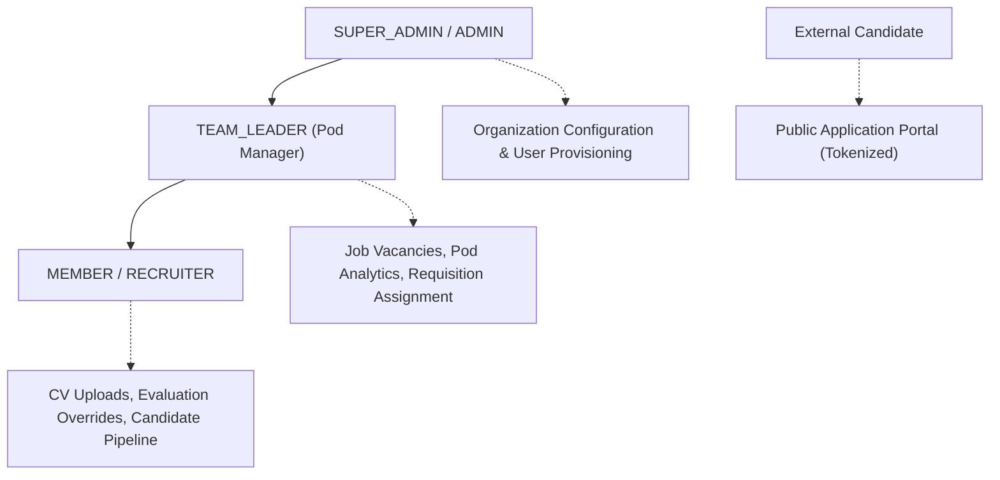
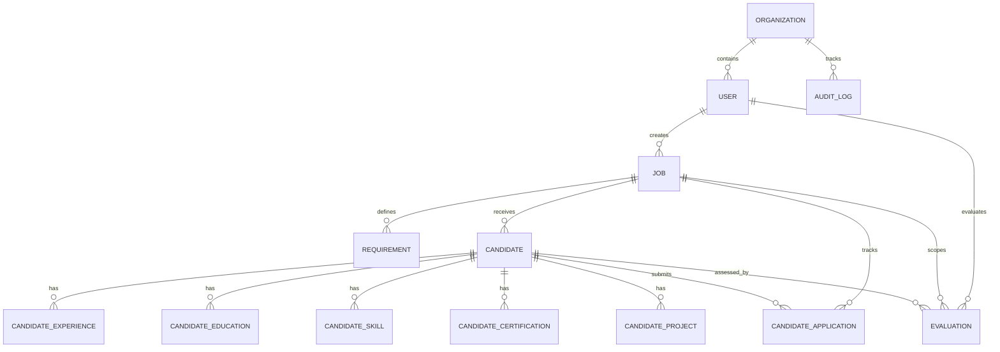
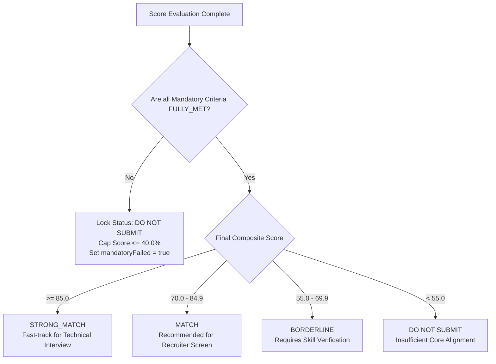

# Product Requirement Document (PRD)

**Product Name:** HireIQ — Enterprise Recruitment Intelligence Platform  
**Document ID:** PRD-HIREIQ-2026-V2.1  
**Live Production URL:** [https://ats-84e3.vercel.app/home](https://ats-84e3.vercel.app/home)  
**Ruleset Version:** Deterministic Evaluation Ruleset v2.1  
**Document Owner:** TaskNera Product & Engineering Core Team  
**Status:** Approved / In Production  
**Target Release:** v2.1 Enterprise Core  
**Last Updated:** November 2026  

---

## 1. Executive Summary & Market Context

### 1.1 The Enterprise Talent Acquisition Crisis
Modern corporate recruitment faces a structural breakdown:
* **High Application Volume**: An average corporate job requisition attracts **250+ applications**, of which **75% to 80% are unqualified or artificially keyword-stuffed**.
* **High Manual Overhead**: Recruiters spend **12 to 18 minutes manually reviewing each resume**, pushing the global average time-to-hire beyond **44 days** and costing organizations over **$4,700 per hire**.
* **Legacy ATS Inadequacy**: Keyword-matching systems (Workday, Taleo, Greenhouse) rely on brittle boolean queries. Qualified candidates using natural synonyms are discarded, while low-quality applicants game systems using hidden white-text keywords.
* **The Perils of Unregulated LLM Screening**: Feeding resumes directly into generative LLMs (e.g., standard ChatGPT or Claude wrappers) introduces **hallucinations, non-deterministic scores** (evaluating the same resume twice yields conflicting results), and severe **EEOC and anti-bias legal liabilities** from unexplainable decisions.

### 1.2 The HireIQ Solution
**HireIQ** by TaskNera is a deterministic, evidence-grounded **Recruitment Intelligence Platform**. It establishes a strict architectural boundary between **semantic extraction** and **candidate evaluation**:
1. **Semantic Extraction**: Google Gemini AI and an NLP pipeline (spaCy, RapidFuzz) extract and structure qualifications, terms, and context.
2. **Deterministic Evaluation**: Candidate scoring is executed exclusively by an algebraic, **100-Point Deterministic Engine (Ruleset v2.1)** running in an isolated Python microservice.

Every evaluation produces:
* A **100% reproducible score** (byte-for-byte identical across repeated runs).
* **Verbatim citations** quoted directly from the CV as proof for every requirement.
* **Mandatory Knock-Out protection** (instant disqualification for unmet hard criteria).
* **Bias Guard (Blind Review)** to anonymize candidate PII for DE&I compliance.
* A cryptographic **SHA-256 audit fingerprint** for compliance and legal defensibility.

---

## 2. Product Objectives & Success Metrics (OKRs / KPIs)

### 2.1 Primary Business Objectives
* Reduce manual resume screening time by **> 90%** while improving shortlist quality.
* Eliminate subconscious human affinity bias and algorithmic hallucination from initial screening.
* Provide enterprise compliance teams with verifiable, cryptographically audited evaluation trails.

### 2.2 Key Performance Indicators (KPIs)

| Metric | Industry Baseline | HireIQ Target / Benchmark |
| :--- | :--- | :--- |
| **Resume Screening Time** | 12–18 minutes / resume | **< 30 seconds / candidate** |
| **Recruiter Daily Capacity** | ~35 resumes / day | **300+ resumes / day** |
| **Time-to-Shortlist** | 10–14 business days | **< 24 hours** |
| **Screening False-Negative Rate** | ~22% (keyword ATS rejections) | **< 3% (verified by citations)** |
| **Score Reproducibility** | Non-deterministic / Subjective | **100% byte-for-byte identical** |
| **Audit Compliance Risk** | High (subjective/unrecorded) | **Zero (SHA-256 immutable log)** |

---

## 3. User Personas & Role-Based Access Control (RBAC)

The system enforces multi-tenant organization isolation and strict role hierarchies defined via the `UserRole` model:



### 3.1 Persona Profiles

#### Persona 1: Platform / Super Administrator (`SUPER_ADMIN`, `ADMIN`)
* **Profile**: Platform operations, HR directors, or TaskNera administrators (`sheetalbedi@tasknera.com`).
* **Core Responsibilities**: Tenant provisioning, subscription plan enforcement, seat quotas, recruiter pod assignments, and global audit log inspection.
* **Key Needs**: Comprehensive audit trails, usage telemetry, and access control management.

#### Persona 2: Pod Manager / Team Leader (`TEAM_LEADER`)
* **Profile**: Lead recruiters and talent acquisition managers overseeing functional pods.
* **Core Responsibilities**: Creating client requisitions, locking requirement weight matrices, assigning requisitions to recruiters, and monitoring funnel conversion velocity.
* **Key Needs**: Workload visibility, candidate funnel analytics, and SLA monitoring.

#### Persona 3: Senior Recruiter / Sourcer (`RECRUITER`, `MEMBER`)
* **Profile**: Full-lifecycle recruiters and talent sourcers.
* **Core Responsibilities**: Batch-uploading CVs, reviewing scorecards, checking verbatim citations, toggling Bias Guard, executing justified overrides, and managing pipeline stages (`SOURCED`, `SCREENING`, `INTERVIEW`, `OFFER`, `REJECTED`).
* **Key Needs**: Rapid qualification summaries, instant evidence validation, and exportable candidate dossiers.

#### Persona 4: External Job Applicant
* **Profile**: Job seekers applying through public career links.
* **Core Responsibilities**: Uploading resumes (PDF/DOCX) and submitting contact information via tokenized public application pages (`/apply/[token]`).
* **Key Needs**: Frictionless submission process without mandatory account creation.

---

## 4. System Architecture & Technical Specifications

HireIQ is built as a distributed, decoupled multi-service platform:

```
┌────────────────────────────────────────────────────────────────────────┐
│                   CLIENT LAYER (Next.js 15 App Router)                 │
│  - Recruiter Dashboard         - Requirement Weighting Matrix          │
│  - Bias Guard (Blind Review)   - Detailed Candidate Scorecards         │
│  - Candidate Summary (PDF/Word)- Sourcing & Public Candidate Portal    │
└───────────────────────────────────┬────────────────────────────────────┘
                                    │ REST API / JWT
                                    ▼
┌────────────────────────────────────────────────────────────────────────┐
│                 BACKEND API GATEWAY (Node.js / Express / TS)           │
│  - Multi-Tenant RBAC Middleware   - Job & Requirement Controller       │
│  - Hiring Reality Engine™         - Candidate Summary PDF/DOCX Gen     │
│  - Decision Intelligence Service  - Centralized Evaluator Orchestrator │
└───────────────────────┬───────────────────────────┬────────────────────┘
                        │                           │
          Prisma ORM    │                           │ Multipart CV / JSON
                        ▼                           ▼
┌───────────────────────────────┐   ┌────────────────────────────────────┐
│      SUPABASE POSTGRESQL      │   │   FASTAPI DOCUMENT PROCESSOR       │
│  - Connection Pooler (6543)   │   │   - PyMuPDF / pdfplumber / Docx    │
│  - Direct DB Access (5432)    │   │   - Tesseract OCR Fallback         │
│  - Multi-Tenant Tenant Tables │   │   - spaCy Linguistic Pipeline      │
│  - Audit Logs & Evaluations   │   │   - Deterministic Engine (v2.1)    │
└───────────────────────────────┘   └─────────────────┬──────────────────┘
                                                      │ Semantic Extraction
                                                      ▼
                                    ┌────────────────────────────────────┐
                                    │      GOOGLE GEMINI AI SUITE        │
                                    │   - Unstructured JD Decomposition  │
                                    │   - Controlled AI Semantic Matcher │
                                    └────────────────────────────────────┘
```

### 4.1 Component Responsibilities

1. **Frontend Layer (`FrontEnd/` — Port 3000)**:
   * Next.js 15.1 (React 19 App Router) with Tailwind CSS dark theme (`#060C1A`).
   * Real-time dashboard KPI widgets, candidate comparison views, and Recharts analytics.
   * Client-side Bias Guard toggle for instantaneous PII masking.

2. **Backend API Gateway (`backend/` — Port 5000)**:
   * Express.js in TypeScript with Prisma ORM 5.22.
   * Multi-tenant data segregation by `organizationId`.
   * JWT stateless authentication (HMAC-SHA256) and Google OAuth2 verification.
   * PDF/DOCX dossier compilation using `pdfkit` and `docx`.

3. **Document Processor Microservice (`document_processor/` — Port 8000)**:
   * Python 3.10+ FastAPI async microservice.
   * Multi-engine parsing: PyMuPDF (fitz), pdfplumber, python-docx, and Tesseract OCR.
   * spaCy NLP pipeline for section segmentation and NegEx negation tagging.
   * Deterministic Scoring Engine (v2.1) computing 100-point algebraic scores.

4. **AI Reasoning Service**:
   * Google Gemini AI (`@google/genai` 2.5 Flash / Pro).
   * Deconstructs raw job descriptions into structured requirement schemas.
   * Bounded semantic alias matching (capped at max +8.0 pts).

5. **Relational Database Tier**:
   * Supabase PostgreSQL with transaction connection pooler (`pgbouncer` port 6543) and direct connection (port 5432).

---

## 5. Functional Requirements (FR)

### FR-01: Authentication, Multi-Tenancy & User Management
* **FR-01.1**: The system shall authenticate users via email/password (bcrypt with 10 salt rounds) and Google OAuth2.
* **FR-01.2**: All protected endpoints must require a valid HMAC-SHA256 Bearer JWT.
* **FR-01.3**: Every data entity (Jobs, Candidates, Evaluations, AuditLogs) must be scoped by `organizationId`. Cross-tenant queries are blocked at the ORM layer.
* **FR-01.4**: Organization administrators can invite recruiters, assign pod roles, and enforce subscription quotas (`maxUsers`, `maxActiveJobs`, `maxResumesPerMonth`).

### FR-02: Job Requisition Lifecycle & Gemini JD Decomposition
* **FR-02.1**: Recruiters can create requisitions via a multi-step wizard specifying client, role, department, work mode, salary bracket, and location.
* **FR-02.2**: The system must accept unstructured job description documents (PDF, DOCX) or raw text.
* **FR-02.3**: Gemini AI shall parse the raw JD and decompose it into a structured schema containing:
  * Technical Skills (with canonical synonyms and aliases).
  * Experience Requirements (minimum years and domain context).
  * Education and Required Certifications.
  * Core Deliverables and Responsibilities.
* **FR-02.4**: Inferred requirements are saved to the database with a default `1.0x` weight.

### FR-03: Dynamic Requirement & Knock-Out Matrix
* **FR-03.1**: Recruiters can assign weights to requirements from `1.0x` (Standard) to `3.0x` (Critical Core).
* **FR-03.2**: Marking a requirement with `is_mandatory = true` registers it with the Mandatory Knock-Out Engine.
* **FR-03.3**: Marking a requirement with `evidence_required = true` forces the engine to cite a verbatim resume excerpt before awarding points.
* **FR-03.4**: Recruiters can define canonical synonyms and acronym aliases (e.g., `K8s` ↔ `Kubernetes`, `GCP` ↔ `Google Cloud Platform`). Non-equivalences (e.g., `Java != JavaScript`, `C != C++`) are strictly enforced.

### FR-04: Hiring Reality Engine™ (Pre-Sourcing Feasibility)
* **FR-04.1**: Prior to sourcing, the system provides a feasibility stress test of the job requisition against labor market realities.
* **FR-04.2**: The engine identifies constraint bottlenecks (e.g., excessive mandatory requirements, below-market compensation, strict on-site work) and calculates pool contraction percentages.
* **FR-04.3**: A what-if relaxation simulator models talent pool expansion and time-to-hire reduction when specific constraints are relaxed.

### FR-05: Multi-Format Document Ingestion & OCR Fallback
* **FR-05.1**: Ingestion supports vector PDF, scanned PDF, Microsoft Word (`.docx`), and plain text (`.txt`).
* **FR-05.2**: The ingestion pipeline follows a strict execution ladder:
  1. For `.docx`: Native decomposition via `python-docx`.
  2. For `.pdf`: Text and coordinate extraction via `PyMuPDF`.
  3. If text density is low (< 150 words) or multi-column tabular data is detected: Detailed extraction via `pdfplumber`.
  4. If the document is an image or scanned document: Automatic fallback to `Tesseract OCR`.
* **FR-05.3**: Sanitization routines strip zero-width characters, invisible white-text keyword exploits, and non-printable Unicode sequences.

### FR-06: Linguistic NegEx & Tenure Extraction Engine
* **FR-06.1**: spaCy isolates standardized sections: `Summary`, `Experience`, `Education`, `Skills`, `Projects`, `Certifications`.
* **FR-06.2**: The NegEx negation detector scans for negative syntactic modifiers (e.g., *"assisted with"*, *"shadowed"*, *"not involved in"*, *"studied in college but no production experience"*). Mentions under negative scopes receive a `CONTRADICTED` or `NOT_FOUND` status.
* **FR-06.3**: Chronology parsing calculates both **Total Career Tenure** and **Directly Relevant Tenure** across role history, preventing candidates from receiving senior-level tenure credit for technologies they used only briefly.

### FR-07: Deterministic Arithmetic Scoring Engine (Ruleset v2.1)
* **FR-07.1**: The scoring engine allocates points across five strict tiers totaling 100 points:
  * **Tier 1: Mandatory Compliance (50 Points)**: Non-negotiable criteria. Each mandatory item receives an equal fraction of the 50 points. Scored as `FULLY_MET` (100%), `PARTIALLY_MET` (50%), or `NOT_MET` (0%).
  * **Tier 2: Core Technical Skills (20 Points)**: Evaluated via exact word-boundary token matching and RapidFuzz token set ratio.
  * **Tier 3: Relevant Experience Tenure (15 Points)**: Ratio of verified relevant experience against the job's minimum requirement.
  * **Tier 4: Responsibilities Alignment (10 Points)**: Evaluates demonstrated role execution (architecture, delivery, team leadership).
  * **Tier 5: Preferred Criteria (5 Points)**: Bonus factors (nice-to-have tools, secondary degrees, domain experience).
* **FR-07.2**: **Mandatory Knock-Out Enforcement**: If any mandatory requirement is `NOT_MET`, the candidate's final status is locked to **`DO NOT SUBMIT`**, and the composite score is hard-capped at **$\le 40.0\%$**.

### FR-08: Controlled AI Semantic Assistance & False-Negative Recovery
* **FR-08.1**: To prevent unfair penalties due to unusual phrasing, Gemini evaluates unmatched items against a 3-state schema: `MATCH`, `UNCERTAIN`, `NO_MATCH`.
* **FR-08.2**: **Safety Boundary**: The maximum positive semantic adjustment is capped at **$+8.0$ points**.
* **FR-08.3**: If any mandatory requirement fails, the semantic adjustment is immediately forced to **$0.0$ points**.
* **FR-08.4**: If the AI service fails or times out, the system automatically falls back to the deterministic base score with zero interruption.

### FR-09: Decision Intelligence Layer & Verbatim Citations
* **FR-09.1**: Every evaluated requirement must display one of four evidentiary states:
  * `PROVEN`: Verbatim quote found showing active production execution.
  * `PARTIALLY_PROVEN`: Mentioned without production evidence or role tenure.
  * `NOT_FOUND`: Zero token or semantic match detected.
  * `CONTRADICTED`: Explicitly negated by NegEx.
* **FR-09.2**: For unmet or partially met criteria, the system automatically suggests targeted technical screening questions for the recruiter's interview.

### FR-10: Bias Guard / Blind Screening Mode (DE&I Compliance)
* **FR-10.1**: Recruiters can toggle Bias Guard with a single click in candidate lists and detailed scorecards.
* **FR-10.2**: When enabled, the UI instantly masks:
  * Candidate full name (replaced by an anonymized token, e.g., `Candidate #4829`).
  * Contact information (email, phone, physical address, LinkedIn, GitHub).
  * Demographic indicators (photos, graduation years, university names).
* **FR-10.3**: Initial shortlisting can be completed entirely on blind merit and evidence before revealing candidate identities.

### FR-11: Candidate Pipeline, Scorecards & Recruiter Overrides
* **FR-11.1**: The candidate pipeline groups applicants into match tiers: High (80–100%), Medium (50–79%), and Low (< 50%).
* **FR-11.2**: Recruiters can override any automated score or decision. Overrides require mandatory justification logging stored in `AuditLog`.
* **FR-11.3**: Recruiters can download executive-ready candidate summaries in PDF or DOCX format containing competency matrices, chronologies, and audit badges.

### FR-12: Public Application Portal & Sourcing Ingestion
* **FR-12.1**: Each requisition supports an unguessable public token (`publicToken`).
* **FR-12.2**: External candidates can submit resumes directly at `/apply/[token]`.
* **FR-12.3**: Uploaded resumes are automatically parsed, evaluated, and assigned to the requisition under the `SOURCED` stage.

---

## 6. Data Models & Entity-Relationship Schema

The database schema is implemented in PostgreSQL via Prisma ORM:



### Core Database Entities

```prisma
enum UserRole {
  SUPER_ADMIN
  CLIENT_ADMIN
  RECRUITER
  ADMIN
  MEMBER
  TEAM_LEADER
}

model Organization {
  id                  String      @id @default(uuid())
  name                String
  companyEmail        String?     @map("company_email")
  contactPhone        String?     @map("contact_phone")
  address             String?
  status              OrgStatus   @default(ACTIVE)
  subscriptionPlan    String      @default("STARTER") @map("subscription_plan")
  maxUsers            Int         @default(5) @map("max_users")
  maxRecruiters       Int         @default(5) @map("max_recruiters")
  maxActiveJobs       Int         @default(20) @map("max_active_jobs")
  maxResumesPerMonth  Int         @default(500) @map("max_resumes_per_month")
  createdAt           DateTime    @default(now()) @map("created_at")
  updatedAt           DateTime    @updatedAt @map("updated_at")
  auditLogs           AuditLog[]

  @@map("organizations")
}

model User {
  id                  String       @id @default(uuid()) @db.Uuid
  email               String       @unique
  password            String
  name                String?
  role                UserRole     @default(MEMBER)
  isActive            Boolean      @default(true) @map("is_active")
  organizationId      String?      @default("org-tasknera") @map("organization_id")
  createdAt           DateTime     @default(now()) @map("created_at")
  updatedAt           DateTime     @updatedAt @map("updated_at")
  jobs                Job[]
  candidates          Candidate[]
  evaluations         Evaluation[] @relation("EvaluatedEvaluations")

  @@map("users")
}

model Job {
  id                    String        @id @default(uuid()) @db.Uuid
  client                String
  position              String
  jd_file_url           String?       @map("jd_file_url")
  jd_text               String?       @map("jd_text")
  status                String        @default("draft")
  publicToken           String?       @unique @map("public_token")
  isPublicLinkActive    Boolean       @default(true) @map("is_public_link_active")
  created_by            String        @map("created_by") @db.Uuid
  organizationId        String?       @default("org-tasknera") @map("organization_id")
  created_at            DateTime      @default(now()) @map("created_at")
  updated_at            DateTime      @updatedAt @map("updated_at")
  requirements          Requirement[]
  candidates            Candidate[]
  applications          CandidateApplication[]
  evaluations           Evaluation[]

  @@map("jobs")
}

model Requirement {
  id                  String   @id @default(uuid()) @db.Uuid
  job_id              String   @map("job_id") @db.Uuid
  requirement         String
  category            String?
  weight              Float    @default(1.0)
  is_mandatory        Boolean  @default(false) @map("is_mandatory")
  evidence_required   Boolean  @default(false) @map("evidence_required")
  aliases             String[] @default([])
  context             String?
  created_at          DateTime @default(now()) @map("created_at")

  @@map("requirements")
}

model Candidate {
  id               String                 @id @default(uuid()) @db.Uuid
  job_id           String?                @map("job_id") @db.Uuid
  organizationId   String?                @default("org-tasknera") @map("organization_id")
  name             String?
  email            String?
  phone            String?
  location         String?
  total_experience String?                @map("total_experience")
  current_title    String?                @map("current_title")
  current_company  String?                @map("current_company")
  resume_file_url  String?                @map("resume_file_url")
  raw_text         String?                @map("raw_text")
  file_hash        String?                @map("file_hash")
  parsing_status   ParsingStatus          @default(UPLOADED) @map("parsing_status")
  created_by       String                 @map("created_by") @db.Uuid
  created_at       DateTime               @default(now()) @map("created_at")
  experiences      CandidateExperience[]
  education        CandidateEducation[]
  skills           CandidateSkill[]
  certifications   CandidateCertification[]
  projects         CandidateProject[]
  evaluations      Evaluation[]

  @@map("candidates")
}

model Evaluation {
  id                  String   @id @default(uuid()) @db.Uuid
  organizationId      String   @default("org-tasknera") @map("organization_id")
  candidateId         String   @map("candidate_id") @db.Uuid
  jobId               String   @map("job_id") @db.Uuid
  score               Float
  atsScore            Float?   @map("ats_score")
  matchLevel          String?  @map("match_level")
  mandatoryCompliance String?  @map("mandatory_compliance")
  mandatoryFailed     Boolean  @default(false) @map("mandatory_failed")
  decision            String   @default("REVIEW")
  status              String   @default("COMPLETED")
  auditData           Json?    @map("audit_data")
  createdAt           DateTime @default(now()) @map("created_at")

  @@map("evaluations")
}

model AuditLog {
  id             String        @id @default(uuid()) @db.Uuid
  organizationId String?       @map("organization_id")
  userId         String?       @map("user_id") @db.Uuid
  action         String
  targetType     String?       @map("target_type")
  targetId       String?       @map("target_id")
  details        Json?
  ipAddress      String?       @map("ip_address")
  createdAt      DateTime      @default(now()) @map("created_at")

  @@map("audit_logs")
}
```

---

## 7. Mathematical Scoring Model & Cryptographic Verification

### 7.1 The 100-Point Composite Formula

$$\text{Final Score} = \min\left(100.0, \; S_{\text{Mandatory}} + S_{\text{Core}} + S_{\text{Experience}} + S_{\text{Responsibilities}} + S_{\text{Preferred}} + \Delta_{\text{AI}}\right)$$

Where:
* $S_{\text{Mandatory}} \in [0, 50]$
* $S_{\text{Core}} \in [0, 20]$
* $S_{\text{Experience}} \in [0, 15]$
* $S_{\text{Responsibilities}} \in [0, 10]$
* $S_{\text{Preferred}} \in [0, 5]$
* $\Delta_{\text{AI}} \in [0.0, 8.0]$ (Subject to: if $\text{MandatoryPassed} = \text{False}$, $\Delta_{\text{AI}} = 0.0$)

### 7.2 Recommendation Decision Matrix



### 7.3 Cryptographic SHA-256 Audit Fingerprint
Every candidate evaluation generates an immutable SHA-256 hash derived from the canonical JSON representation of its parameters:

$$\text{AuditPayload} = \left\{ \text{rules\_version}, \text{job\_id}, \text{candidate\_id}, \text{overall\_score}, \text{mandatory\_passed}, \text{category\_scores}, \text{criteria\_statuses} \right\}$$

$$\text{SHA-256 Hash} = \text{HexEncode}\left(\text{SHA256}\left(\text{CanonicalJSON}(\text{AuditPayload})\right)\right)$$

Any retroactive modification to score values, weights, or cited evidence alters the hash, creating an instantly detectable tamper flag.

---

## 8. Non-Functional Requirements (NFR)

### NFR-01: Determinism & Idempotency
* Evaluating the identical candidate resume text against the identical job description $N$ times under Ruleset v2.1 must produce the exact same score, category distribution, and citations across all $N$ runs.

### NFR-02: Performance & Throughput SLAs
* **Vector PDF Extraction**: $\le 1.2$ seconds per 3-page CV.
* **Scanned OCR Ingestion**: $\le 4.5$ seconds per document.
* **Full Evaluation Pipeline**: $\le 2.5$ seconds from file upload to completed scorecard.
* **Batch Capacity**: The Python microservice must support batch processing of **100+ CVs concurrently** using asynchronous worker threads without process crashes.

### NFR-03: Security & Data Privacy
* Passwords hashed using `bcrypt` (10 salt rounds).
* All API endpoints secured with stateless HMAC-SHA256 JWTs.
* Multi-tenant data segregation enforced via `organizationId` indexing.
* End-to-end transport encryption via TLS 1.3 and database storage encryption via AES-256.
* **Commercial AI Privacy Agreement**: Google Gemini API is accessed under enterprise terms ensuring **zero customer resume data is retained or used to train base models**.

### NFR-04: High Availability & Fault Tolerance
* If the external AI service becomes unresponsive or hits rate limits, the system automatically falls back to pure deterministic scoring with zero downtime.

---

## 9. Failure Modes & Resilience Strategies

| Failure Scenario | Risk | System Mitigation Strategy |
| :--- | :--- | :--- |
| **Scanned/Photo Resume** | Zero selectable text layer | System automatically falls back to `pytesseract` OCR engine. |
| **Multi-Column Resumes** | Scrambled reading order | `pdfplumber` isolates columnar and table coordinates. |
| **White-Text Exploit** | Keyword stuffing exploit | Word-boundary token matching and required tenure verification prevent unearned points. |
| **Gemini AI Service Outage** | Screening pipeline stall | Pure deterministic fallback executes with zero AI adjustment ($\Delta_{\text{AI}} = 0.0$). |
| **Ambiguous Job Titles** | Miscalculated relevant tenure | Canonical taxonomy mapping standardizes designations against O*NET benchmarks. |
| **Negated Skill Phrasing** | False-positive skill awards | NegEx syntactic dependency analysis identifies disclaimers and flags `CONTRADICTED`. |

---

## 10. Verification & Sign-off

This document represents the official Product Requirement Document (PRD) for the **HireIQ Enterprise Recruitment Intelligence Platform (Ruleset v2.1)**. All implementations in the `backend/`, `document_processor/`, and `FrontEnd/` repositories adhere strictly to these specifications.

